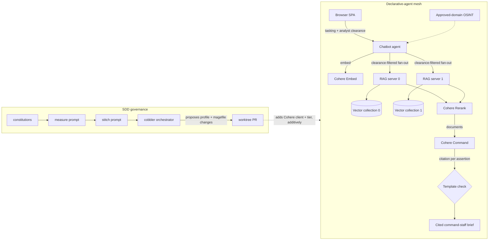

# cohere-demo

An on-premise assistant that synthesizes multi-source intelligence into cited command-staff briefs, built on Cohere and delivered as an additive provider on a declarative-agent mesh.

## Approach

A defense ministry cannot send sovereign intelligence to a hosted API, and cannot act on a brief whose claims it cannot trace. The constraints are architectural, not contractual: the models that read the documents must run inside the enclave, and every assertion must cite the source it came from. Cohere meets both. Command, Embed, and Rerank deploy inside the customer boundary, and Command composes with the retrieved documents as first-class input and returns a citation span for each assertion it writes.

We build that solution as an additive change on a running declarative-agent mesh. The mesh is a working multi-agent assistant: a browser-facing agent embeds a tasking once, fans the embedding out to retrieval servers, and composes an answer from the surviving chunks, every agent a YAML profile on a shared runtime so the topology is configuration rather than orchestration code. Adding the Cohere provider is a new REST client, a new model tier, and a clearance-gated retrieval path that the constitutions forbid from mutating the agents already in place. The specifications, not the code, decide what the next change may touch.

## System



The Cohere Embed, Rerank, and Command stages, the clearance filter, the approved-domain lookup, and the template check are the additive provider path; the Ollama tier remains available unchanged. Retrieval narrows two ways under the model's own tool call: Command proposes source tiers and a date window, the machine renders both as a declared metadata filter over each chunk's issued date, and analyst facet checkboxes override the proposal. A tasking whose window matches no reporting composes an explicit empty brief — zero claims, zero citations — rather than a confident brief from another period.

## Scope and status

The target is an on-premise assistant that runs the real Cohere models and demonstrates the DefTech intelligence-synthesis solution design end to end, verified by the mesh's own integration gates.

What is built: the full assistant. The chatbot turn embeds with Cohere Embed, orders with Rerank, and composes with Command's structured citations; retrieval is clearance-gated end to end, with a reader-release floor, an Admiralty grade on every source, and cited text tinted by its sources' classification. The model proposes source tiers and date windows by native tool call, and an out-of-range tasking composes an honest empty rather than a wrong-period brief. Around the core turn sit a sentence-level citation audit judged by the classifier tier, an audit-driven refine loop, one-for-one translation renditions that never pass citations through the model, web harvest into a scratch corpus, PDF delivery, and live retrieval-recall evaluation over a generated reference corpus. Every turn's cross-agent trace renders its model calls with their prompts and answers. A 105-check browser gate, the 178-test SPA suite, and the specification audit gate every merge.

What is planned: the filed roadmap — a machine-side audit loop, agentic search inside revision, and per-tier RAG units. The Cohere units entered additively; the running Ollama mesh is not modified.

## Methodology

Specifications are the source of truth, and code serves them. The constitutions under `docs/constitutions/` state the rules a coding agent obeys: document schemas, execution and planning discipline, Go and profile authoring standards. The cobbler orchestrator drives a measure-then-stitch loop, proposing a unit of work from the corpus and executing it against the constitutions. Work reaches `main` only through an issue, a worktree branch, and a pull request, so every change is reviewable and traceable to the requirement that motivated it.

## Repository structure

```
docs/constitutions/   rules the coding agent obeys (design, execution, planning, testing, interface, go-style, profile-style)
docs/prompts/         measure and stitch prompt templates for the orchestrator
docs/                 SDD corpus: VISION, ARCHITECTURE (reframed for the Cohere solution), SPECIFICATIONS, road-map, specs/
configuration.yaml    cobbler orchestrator configuration
magefiles/            mage targets: orchestrator plus the mesh build, demo, and integration gates
agents/               declarative agent profiles that form the mesh; the Cohere provider lands here additively
helm/                 one chart that deploys the mesh and its in-cluster model tier
.claude, .opencode    symlinks to the shared coding-skills toolchains
```

## Technology choices

Cohere for the model tier, because the DefTech constraints are architectural: Command, Embed, and Rerank deploy inside the customer boundary for a sovereign, air-gapped deployment, Command returns model-native citations rather than prompt-engineered ones, and Rerank lifts retrieval recall — a combination a hosted-only provider cannot match. Declarative agent profiles over bespoke orchestration code, because a mesh expressed as configuration is one a specification can govern and an agent can extend without rewriting control flow. Mage over shell scripts for the build, because the orchestrator targets and the mesh targets share one Go-typed namespace and collisions surface at compile time. Pixi manages any Python the corpus tooling needs, so environments are declared and reproducible rather than assumed.

## Build and test

The build needs Go and mage. The platform dependency — agent-core, the shared magefiles, and the catalog — comes from the `mesh-intelligence/declarative-agents` modules, which `go.mod` pins at one upstream commit and names in a comment above the require block.

Those modules, the published agent-core image, and its charts are private. Every machine and CI runner tells Go to fetch the organization's modules directly rather than through the public proxy and checksum database:

```bash
go env -w GOPRIVATE=github.com/mesh-intelligence
```

Git then needs a credential for github.com from a token that holds `contents:read` on `mesh-intelligence/declarative-agents`; CI also needs `read:packages` on the same token for the image. A namespace that runs the published `ghcr.io/mesh-intelligence/declarative-agents/agent-core` image needs an `imagePullSecret` built from that token. `mage deps:doctor` checks the first two and names the command or scope that fixes a gap; `mage deps:verify` checks that the three pins name one release and that every chart image under the published prefix carries that release's tag.

The corpus data is split the same way (srd017 R9.7): this repository tracks
the synthetic tier's built chunks and every tier's provenance README, while
the source datasets and the keep-private tiers' chunks live in the private
`mesh-intelligence/cohere-demo-data` repository, cloned beside this one. With
org access to the modules above but without that checkout, a clone builds and
seeds the synthetic tier alone. Without org access this repository can be read
but not built, because its Go modules, runtime image, and npm kit are private;
[docs/guides/going-public.md](docs/guides/going-public.md) records the split
and what publishing this repository requires.

List every target:

```bash
mage -l
```

The mage targets locate those modules through the Go toolchain, so they build against the same agent-core the compiler does. A committed `go.work` points the build at a sibling `declarative-agents` checkout when one is present, which is the development loop: edit the platform beside the demo and the change is visible immediately. Build with `GOWORK=off` to get what the pin alone resolves, from the module cache and with no sibling checkout at all. Because `go.work` is committed, a clone whose sibling checkout is missing needs `GOWORK=off` on `go` and `mage` commands; without it the toolchain reports the workspace directories it cannot load.

`mage app:up` prints the agent-core directory and version it resolved, and says so when a workspace checkout has moved away from the commit `go.mod` pins — that run builds the checkout, not the pin.

Move the pin with the `deps:pin` target, which resolves an upstream release tag to its commit, pins all three modules there together, and records the release name in `go.mod`:

```bash
mage deps:pin v0.20261005.0
```

Toolchain resolution is overridable for a checkout it cannot reach: set `core_root` in `demo.yaml` to point the agent-core root somewhere else, and `catalog_root` for the catalog. Both ship unset, and setting either pins that root to one layout again. The audit's specification-critic profile resolves from the catalog root; override it by setting `spec_critic_profile` in `demo.yaml`.

A GKE session (bring-up, seed, verify, IAP checks, teardown, budget, and cost) follows [the GCP runbook](docs/guides/gcp-runbook.md).

Run the self-governance gate over the specification corpus:

```bash
mage audit
```

The gate also covers the browser SPA. Its bundle under `agents/chatbot/ui/app/dist` is committed and the chart stages it into the pod, so `mage audit` runs the SPA test suite and then rebuilds the bundle into a temporary directory and compares it byte for byte against the committed one. A source change nobody rebuilt fails with the files that differ and the command that fixes them. The vite build is deterministic, which is what makes that comparison an assertion rather than an approximation. Run either half alone while iterating:

```bash
mage ui:test
mage ui:bundle
```

Both need `npm`, and both skip with a stated reason when it is absent rather than failing a machine that cannot answer the question. The SPA takes its design tokens and kit panels from `@mesh-intelligence/ui-kit`, published on GitHub Packages with each declarative-agents release, so the first install needs a token with `read:packages` logged in for the `@mesh-intelligence` scope; `agents/chatbot/ui/app/.npmrc` names the command.

## Running the demo

The demo runs as one application on the shared, versioned `da-platform`: the
kind cluster every mesh-intelligence application deploys onto, named for the
declarative-agents release `go.mod` pins. `mage platform:up` brings that
cluster up, or re-proves a running one, and leaves it running. `mage app:up`
deploys the mesh into its own namespace, `app-cohere-demo`, through upstream's
application runner, which installs through the catalog applier and rolls back
through it when verification fails. Nothing else on the platform moves, so
cohere-demo runs beside upstream chatbot-mesh on the same cluster.

```bash
mage platform:up
mage app:up
```

`app:up` builds the agent-core runtime image from a git checkout of
agent-core, which the committed `go.work` resolves to the sibling
`declarative-agents` checkout at the pinned release. It stages the chart,
provisions the UI archives and profiles outside the release, creates the
Cohere and SerpAPI credential Secrets in the namespace from `COHERE_API_KEY`
(or `.secrets/keys.json`), and deploys the Cohere tier when a credential
resolves and the Ollama tier when none does. It prints the agent-core
directory and version it resolved, and says so when a workspace checkout has
moved away from the commit `go.mod` pins.

The mesh answers on three hosts through the platform ingress:

| Surface | URL |
|---|---|
| Chat SPA and API | http://cohere-demo.localhost |
| Fleet observer | http://observer.cohere-demo.localhost |
| Trace query surface | http://telemetry.cohere-demo.localhost |

`app:up` leaves Chroma empty, and the rag-server binds its collection at
startup, so a seed also has to restart the rag-server or every turn answers
from model priors with no fault in any log. `mage app:seed` performs the whole
sequence: it port-forwards each RAG unit's in-cluster Chroma, writes the
corpus from the committed chunk store, restarts the rag-server, waits for the
rollout, and tears the forward down. It fails loudly when Chroma is
unreachable. `mage app:verify` then posts a tasking and asserts the response's
composed sources carried retrieved documents, printing each RAG unit and the
number of chunks it contributed; composition alone would not prove it, because
a rag-server bound to an empty collection still appears in
`metadata.sources.composed`.

```bash
mage app:seed
mage app:verify
```

The same turn by hand, when you want to see the answer:

```bash
curl -s -X POST http://cohere-demo.localhost/api/v1/chat \
  -H 'Content-Type: application/json' \
  -d '{"message":"What are the Chroma corpus agents?","history":[]}'
```

`mage app:status` prints the application's health as JSON, and
`mage app:diagnose` captures the platform's canonical evidence for the
release. The collector writes traces to the application bucket
`gs://cohere-demo-telemetry`, so they survive a collector restart and a
redeploy. `mage app:down` removes the release and its namespace and keeps the
bucket; `mage app:purge purge:cohere-demo` deletes the application's telemetry objects, and refuses anything but that exact token. `mage demo:up` and
`mage demo:down` remain as `platform:up` plus `app:up`, and `app:down`.

## The Cohere provider tier

The Cohere Command composition tier reaches the provider through one declared
REST client whose base URL and egress allowlist are a single deployment-supplied
pair, so the hosted endpoint and a private in-boundary deployment differ by
configuration alone. The credential is read from `COHERE_API_KEY` by the
runtime's credential resolver; it is operator-supplied and appears in no profile,
prompt, log line, or exported span. When the variable is not exported, the mage
tooling falls back to the `cohere` field of `.secrets/keys.json`, a gitignored
operator store, and forwards the resolved value onward through the environment.

Two scenario critics prove the turn and its degradation against mock
dependencies, need no credential and no network, and run inside `mage
integration:rig`. The live tier is separate:

```bash
mage integration:cohere
```

It composes a brief against the real provider, drives a rejected credential to
prove the turn degrades to the Ollama tier rather than failing, and confirms the
client refuses a host outside the configured allowlist. It skips, naming
`COHERE_API_KEY` and `.secrets/keys.json`, when neither supplies a credential,
so `mage integration:all` stays green on a machine with no Cohere access.

## Deploying to GKE

This section describes the footprint; [the GCP runbook](docs/guides/gcp-runbook.md) gives a session's steps in order, what to check at each, and what it costs. Every `gcp:*` verb appends its phase lines to `build/gcp/<YYYY-MM-DD>.log`.

The GCP footprint is Terraform this repository owns, under `infra/gcp/`: four
modules hold the resource shapes, `envs/dev` and `envs/prod` compose them with
different lifecycle choices, and `bootstrap/` creates the state bucket the
environments keep their state in. A gitignored `gcp.yaml` beside the
repository root selects the project and environment:

```yaml
project: <project-id>
region: us-central1          # default
environment: dev             # selects infra/gcp/envs/<environment>; default dev
# prod_project: <other-id>   # required for environment: prod
cohere_demo:
  iap_members: [user:<your-account>]
```

The verbs need terraform 1.9+, gcloud with `gcloud auth application-default login`,
and kubectl, and read `ghcr_username` from `.secrets/keys.json`. The Terraform
runner and the GCP helpers they use live in this repository
(`magefiles/gcp_terraform_runner.go`, `magefiles/gcp_cloud.go`); nothing
GCP-specific comes from declarative-agents, whose `apprig` deploy machine is the
only part `gcp:deploy` shares with the kind path.

| Verb | What it does |
|------|--------------|
| `mage gcp:up` | Applies `bootstrap/` (local state; imports an existing state bucket by name), then the environment root with state at `gs://<project>-tfstate/cohere-demo/<environment>`; prints the outputs. A second run reports both roots unchanged. |
| `mage gcp:plan` | Shows what `gcp:up` would change in the environment root. |
| `mage gcp:secrets` | Stores each credential from `.secrets/keys.json` in its Secret Manager entry over stdin; keeps an entry that already has a version. `gcp:secretsRotate` adds a version regardless. |
| `mage exporter:publish` | Builds the brief exporter for linux/amd64 and linux/arm64 over the pinned agent-core release and pushes it to `ghcr.io/mesh-intelligence/cohere-demo/exporter`; leaves an already published tag alone. Needs a `docker login ghcr.io` with `write:packages`. |
| `mage gcp:deploy` | Deploys the release onto the environment's cluster. |
| `mage gcp:seed` | Seeds the cloud release's collections from the committed chunk store, as `app:seed` does on kind. |
| `mage gcp:verify`, `gcp:verifyTrace`, `gcp:exporter` | Run the `app:verify`, `app:verifyTrace`, and `integration:exporter` assertions against the cloud release through port-forwards. |
| `mage gcp:budget` | Creates or updates the project's `cohere-demo` budget on its billing account, alerting at 50, 90, and 100 percent of `budget_amount` (default 100, in the account's currency). |
| `mage gcp:down delete-cohere-demo-<environment>` | Drains persistent volumes, then destroys the environment root: cluster, registries, telemetry bucket, identity, secret containers. Reports any stranded `pvc-` disk. The state bucket stays. |
| `mage gcp:bootstrapDown delete-cohere-demo-tfstate` | Removes the state bucket when the demo is retired; refuses while the bucket holds any state, cohere-demo's or another root's. |

`gcp:deploy` builds and uploads no image. The nodes pull every image through
the environment's two Artifact Registry remote repositories:
`cohere-demo-ghcr` fetches the published agent-core release image from ghcr.io
at the tag `helm/values.yaml` pins (the one `deps:verify` holds to the
release) and the brief exporter `exporter:publish` pushed, tagged
`<agent-core release>-<recipe digest>`, authenticating with the GitHub token Artifact Registry reads from
Secret Manager, and `cohere-demo-dockerhub` fetches Chroma, Dolt, kubectl,
busybox, and the applier's CLI donor from Docker Hub. Each repository caches
what it fetched, and no token reaches the cluster. The verb then points the
`app-cohere-demo` service account at the `cohere-demo-objectstore` Google
service account and deploys through the canonical applier with
`helm/ci/gcp-values.yaml` in place of the kind values.
Before it changes anything, it asks the ghcr.io repository for the exporter
tag and refuses, naming `exporter:publish`, when ghcr.io does not carry it; a
pin bump or an edit to `images/exporter.Dockerfile` therefore needs one
publish before the next cloud deploy.
The cloud tier is Cohere-only: there is no in-cluster Ollama, so a provider
failure ends the turn instead of degrading it.

A project where declarative-agents' rig already created cohere-demo's bucket,
service account, and secrets needs those released once before the first
`gcp:up`, which otherwise stops on the name collision and prints the steps:
remove cohere-demo from that repository's `gcp.yaml` `applications:`,
`terraform state rm` its cohere-demo addresses in the `applications` state
prefix, and delete the released objects with `gcloud`.

The credentials live in Google Secret Manager, never on the workstation path.
The environment root creates five secrets (`cohere-demo-cohere-api-key`,
`-serpapi-api-key`, `-iap-client-id`, `-iap-client-secret`, `-ghcr-pull`); the
first four are readable by the application namespace's identity alone and
`-ghcr-pull` by Artifact Registry alone. `cohere_demo.host`
in `gcp.yaml` optionally names a domain in place of the reserved address's
sslip.io name.

Terraform holds the secret, not its value. The values live in the operator's
gitignored `.secrets/keys.json`, and `mage gcp:secrets` stores each one as a
new version through `gcloud secrets versions add --data-file=-`, on stdin, so
no value reaches a command line, an environment variable, shell history, or
Terraform state. A secret that already has a version is kept;
`mage gcp:secretsRotate` adds a new one regardless. A field `keys.json` lacks
is named and skipped.

Table 1. keys.json fields the GCP verbs read

| Field | Secret Manager entry | Read by |
|-------|----------------------|---------|
| `cohere` | `cohere-demo-cohere-api-key` | chatbot pods, through secret sync |
| `serpapi` | `cohere-demo-serpapi-api-key` | chatbot pods, through secret sync |
| `iap_client_id` | `cohere-demo-iap-client-id` | the exposure root's IAP policy, as a `gcp:deploy` variable |
| `iap_client_secret` | `cohere-demo-iap-client-secret` | the IAP `GCPBackendPolicy`, through secret sync |
| `ghcr_pat` | `cohere-demo-ghcr-pull` | Artifact Registry's ghcr.io remote repository; no pod |
| `ghcr_username` | none (a `gcp:up` variable) | the ghcr.io remote repository's upstream login |

`keys.json` is the only copy of the OAuth client secret and the GitHub token,
so back it up with the rest of the operator store. The secret entries belong
to the environment and go with `gcp:down`, so a session runs `gcp:up`, then
`gcp:secrets`, then `gcp:up` once more the first time a `ghcr_pat` is stored
(Artifact Registry reads the token when it creates the ghcr.io repository),
then `gcp:deploy`.

Before deploying, `gcp:deploy` checks that each secret has an enabled version,
reading version metadata only, and names any secret that lacks one. It then
applies a SecretProviderClass and one SecretSync per credential into
`app-cohere-demo`. GKE's sync controller, authenticating as the namespace's
service account through Workload Identity, writes the `cohere-credential` and
`serpapi-credential` Secrets the chart already references, so the chart and
declarations stay the same as on kind. To rotate a value, change it in
`keys.json` and run `mage gcp:secretsRotate`. With sync rotation enabled on the cluster the Secret follows within
the rotation interval; the agents read the key at start, so
`kubectl rollout restart deployment --namespace app-cohere-demo` (or the next
`gcp:deploy`) puts it in effect.

Only the chatbot is public, over HTTPS behind Identity-Aware Proxy (IAP), because
the corpus carries clearance-marked documents. Terraform owns the whole edge.
The bootstrap root holds the global address `cohere-demo-ingress`, so it
outlives every session, and the chatbot serves at
`<address-with-dashes>.sslip.io`, which resolves to that address with no DNS
record, unless `cohere_demo.host` names a domain whose A record points there.
After the release applies, `gcp:deploy` applies the environment's exposure
root (`infra/gcp/envs/<env>/exposure`): a GKE Gateway on the address with a
Certificate Manager certificate for the host, an HTTPRoute to the chatbot
alone, a `GCPBackendPolicy` that puts IAP in front of it, and
`roles/iap.httpsResourceAccessor` for each `cohere_demo.iap_members` entry,
so any other signed-in account gets 403. The Google front end and IAP add
headers to every request (`via`, `x-cloud-trace-context`, and three
`x-goog-*` headers), and the agent-core REST server refuses a header a route
does not declare. The load balancer refuses to remove `x-goog-*` headers, so
the GKE overlay lists them in `ingress.gke.transportHeaders` and every public
chatbot route declares them; they are accepted, never trusted, and agent-core
carries no cloud-provider header names. The
control plane at `/provisioning`, the observer, and the collector are not
routed at all; the operator reaches them with `kubectl port-forward`. The
certificate takes about 15 minutes to issue on a new host.

The project sits in a Google Cloud organization, and IAP's Google-managed OAuth
client admits only that organization's accounts. A `@gmail.com` owner therefore
needs a custom OAuth client, created once in the console (Google retired the
API that created them): enable the IAP API, configure the OAuth consent screen
with the External user type and add the owner as a test user, then create an
OAuth client ID of type Web application with the redirect URI
`https://iap.googleapis.com/v1/oauth/clientIds/<client-id>:handleRedirect`.
Put the pair in `keys.json` as `iap_client_id` and `iap_client_secret`;
`gcp:secrets` stores them and the sync writes them into the
`cohere-demo-iap-oauth` Secret the `GCPBackendPolicy` reads. To admit
another viewer, add the account to `cohere_demo.iap_members` (and as a consent
screen test user) and run `gcp:deploy` again.

## Browser end-to-end tests

The browser end-to-end tests for the machine-request UI are owned by the
canonical documentation-curator package in the sibling catalog, at
`../declarative-agents/applications/catalog/agents/knowledge-manager/documentation-curator/ui/docs/`.
That package owns the `puppeteer-core` dependency; it does not live in
agent-core. Install with `npm ci`, then run the machine-request suite from the
package directory:

```bash
npm ci
npm run test:e2e:machine-request -- --executable-path=/path/to/browser
```

The `test:e2e:machine-request` script carries its own `--base-url` and
`--artifact-dir` defaults; pass `--executable-path=/path/to/browser` to point
Puppeteer at a locally installed Chromium or Chrome.

## Licensing

MIT, Copyright (c) 2026 Mesh Intelligence Inc.. See [LICENSE](LICENSE).
