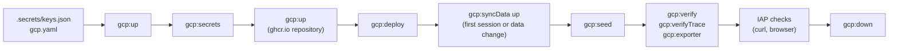

<!-- Copyright (c) 2026 Mesh Intelligence Inc. -->
<!-- SPDX-License-Identifier: MIT-0 -->

# Running the demo on GKE

This runbook takes the demo from nothing in the cloud to an answer drawn from
the corpus behind Identity-Aware Proxy (IAP), proves it, and takes it down again. The
README's [Deploying to GKE](../../README.md#deploying-to-gke) section explains
what each verb creates and why; here we give the order, what to check at each
step, and what a session costs. Every command runs from the repository root.

A session leaves nothing billing behind it except one reserved address and
the private corpus bucket, both owned by the bootstrap root. The dev environment destroys its public edge,
cluster, registries, telemetry bucket, identity, and secret containers on
`gcp:down`, so each session starts from the same
empty project and the same two local files.



## Before the first session

We need four things on the workstation: terraform 1.9 or later, the Google
Cloud CLI with `gcloud auth login` and `gcloud auth application-default login`
done, kubectl, and helm. Two gitignored files carry everything else.

`gcp.yaml` beside the repository root names the project and who may open the
demo:

```yaml
project: <project-id>
region: us-central1
environment: dev
cohere_demo:
  iap_members: [user:<your-account>]
# billing_account: <id>   # gcp:budget reads the project's link when absent
# budget_amount: 100      # in the billing account's currency
```

`.secrets/keys.json` holds every credential, and nothing is pasted during a
session. Table 1 lists the fields the cloud verbs read.

Table 1. Credentials a GKE session reads from keys.json

| Field | Used for |
|-------|----------|
| `cohere` | the Cohere tier (embed, rerank, classify, compose) |
| `serpapi` | the OSINT search leg when a deploy opts into it |
| `ghcr_username`, `ghcr_pat` | Artifact Registry's pull of agent-core and the exporter from ghcr.io; a classic token with `read:packages` is enough |
| `iap_client_id`, `iap_client_secret` | the custom OAuth client IAP signs viewers in with |

The OAuth client is the one manual step, done once per project in the Cloud
console: configure the consent screen as External with the owner as a test
user, create a Web application client, and add the redirect URI
`https://iap.googleapis.com/v1/oauth/clientIds/<client-id>:handleRedirect`.
The README has the reason a `@gmail.com` owner needs it.

The brief exporter image must exist on ghcr.io at the tag the current pin and
`images/exporter.Dockerfile` derive. After a pin bump or a Dockerfile edit, we
run `mage exporter:publish` once; `gcp:deploy` refuses and names that verb
when the tag is missing.

Finally, we put a ceiling on spend. `mage gcp:budget` enables the Billing
Budgets API and creates one budget named `cohere-demo` on the project's billing
account, scoped to the project, alerting the billing administrators at 50, 90,
and 100 percent of actual spend. Running it again updates the amount rather
than adding a second budget. The amount is in the billing account's currency,
because the Budgets API rejects any other; our account bills in Canadian
dollars, so the default of 100 is CAD 100. The verb runs this command, which
anyone with Billing Account Administrator can repeat by hand:

```bash
gcloud billing budgets create --billing-account=<account> --display-name=cohere-demo --budget-amount=100CAD --filter-projects=projects/<project-id> --threshold-rule=percent=0.5 --threshold-rule=percent=0.9 --threshold-rule=percent=1.0
```

To change the figure, set `budget_amount` in `gcp.yaml` and run `gcp:budget`
again. A budget alerts; it never stops a resource. `gcp:down` is what ends the
spend.

## Bring-up

Table 2 is the bring-up sequence. The first `gcp:up` creates the state bucket
if it is missing, then the environment: the Autopilot cluster, the Docker Hub
remote repository, the telemetry bucket and its service account, and the five
empty secret containers. It stops short of the ghcr.io repository, because
Artifact Registry checks the GitHub token when it creates that repository and
the token is not stored yet.

Table 2. Bring-up, in order

| Step | Command | What to check |
|------|---------|---------------|
| 1 | `mage gcp:up` | `phase ... name=dev ... outcome=applied` and the message to run `gcp:secrets`; about nine minutes, most of it the cluster |
| 2 | `mage gcp:secrets` | `stored a new version` naming all five entries |
| 3 | `mage gcp:up` | `ghcr_path` is no longer empty; about 30 seconds |
| 4 | `mage gcp:deploy` | `phase ... name=deploy ... outcome=applied`, then `name=exposure ... outcome=applied` for the Gateway, certificate, and IAP policy |

The Google front end and IAP add request headers that agent-core refuses as
undeclared, which answered `400` to every browser request behind the old
Ingress. The load balancer refuses to remove `x-goog-*` headers, so the GKE
overlay's `ingress.gke.transportHeaders` has every public chatbot route
declare them (#883); the gates below reach the mesh through port-forwards and
never see them.

`gcp:deploy` prints the public address,
`https://<address-with-dashes>.sslip.io`. The Certificate Manager certificate
for that host issues only once the Gateway serves the address: an
authorization attempt made before then fails (`RESOLVED_TO_NOT_SERVING`,
`CERTIFICATE_NOT_ATTACHED`), and the retry came about 40 minutes later in the
2026-10-05 session. Until the certificate is active, and for a minute or two
after, the TLS handshake resets rather than showing an IAP page.
`gcloud certificate-manager certificates describe cohere-demo-chatbot` shows
the attempt and its state.

## Sync the private data

The chunk store is split by licence verdict (srd017 R9.7): the publishable
tiers are tracked in this repository, and the keep-private tiers live in the
private `mesh-intelligence/cohere-demo-data` checkout beside it. `mage
gcp:syncData up` mirrors that checkout into the bootstrap root's private
corpus bucket (`<project>-corpus`), which is the operator-independent copy --
run it on the first session and after any data change; the private repository
stays the source of truth. A fresh workstation goes the other way: `mage
gcp:syncData restore` fills `../cohere-demo-data` from the bucket (then
decompress the Telegram CSV once, as the command prints). `gcp:down` leaves
the bucket the way it leaves the reserved address; `gcp:bootstrapDown`
removes it with the rest. If a future release moves ingest in-cluster, the
bucket is the natural in-cluster source: grant the application's service
account `roles/storage.objectViewer` on it then, not before.

## Seed and verify

The cloud release starts with empty collections. `mage gcp:seed` writes the
chunk store -- the tracked publishable tiers united with the private
checkout's keep-private tiers -- into Chroma through a port-forward and
restarts each RAG server so it rebinds the seeded collection; it calls no
embedding provider, because the store already carries Cohere vectors under
the identity the release declares, and it refuses when the two disagree.
Without the private checkout it seeds the publishable tiers alone and says
so; the full demo wants the full corpus.

The gates then run the same assertions the kind path runs, through
port-forwards that reach the mesh behind IAP. They prove the mesh; the edge is
checked separately below. Table 3 lists them.

Table 3. Cloud gates

| Command | Proves |
|---------|--------|
| `mage gcp:verify` | a brief answered by the Cohere tier from composed, cited, reranked sources, with the query embedded by Cohere |
| `mage gcp:verifyTrace` | from the turn's own trace: Embed, the classifier, Rerank, and Command ran; the clearance gated retrieval; the egress inventory is the declared surface; no credential left redaction |
| `mage gcp:exporter` | an analyst edit exported to a PDF that is the exporter pod's own rendered artifact |

To check that the seeded collections are on persistent disks rather than in
the pod, we delete the Chroma pod and run `gcp:verify` again once the
replacement is ready. The kubeconfig the verbs write is temporary, so for
manual `kubectl` work we fetch one into a private file:

```bash
KUBECONFIG=build/gcp/kubeconfig gcloud container clusters get-credentials cohere-demo-dev --project <project-id> --region us-central1
```

## The edge

IAP is the only way in. We check from the workstation and in a browser.
Table 4 lists the expected answers. A non-member identity is easiest to
produce in the cluster: a pod in `app-cohere-demo` asks the metadata server
for an ID token whose audience is the OAuth client ID, which is the
`cohere-demo-objectstore` service account and is not an IAP member.

Table 4. Edge checks, with what the 2026-10-05 session observed at v0.20261005.0

| Check | Expected | Observed |
|-------|----------|----------|
| `curl -sI https://<host>/` with no cookie | `302` to `accounts.google.com` | `302` to `accounts.google.com` with the custom OAuth client; certificate from Google Trust Services for the host |
| `curl -sI http://<host>/` | no answer on port 80; the load balancer serves HTTPS only | connection reset, no answer |
| `curl -sI https://<host>/provisioning`, `/monitor-proxy/`, `/api/v1/chat` | the same `302`; behind the sign-in the HTTPRoute routes only the chatbot, so the control plane, observer, and collector are unreachable from the internet | the same `302` on each path |
| a token for an identity not in `iap_members` | `403` from IAP | `403` |
| a port-forward request carrying each edge header (`via`, `x-cloud-trace-context`, `x-goog-*`) | `200`; an undeclared header still `400` | `200` for each; `400` for an undeclared header |
| the owner signs in | the chatbot UI, and a turn answers | the UI loaded and a turn on December 2022 strikes answered with citations |
| `kubectl rollout restart deploy/cohere-demo-chatbot-mesh-collector` | completes with no strategy patch | `Recreate` on the WAL claim; rolled out in 12 seconds |

## Teardown

`mage gcp:down delete-cohere-demo-dev` first destroys the exposure root
(`name=exposure ... outcome=destroyed`), so the load balancer goes before its
backends, then deletes the release's persistent volume claims and waits for
their disks to go, then destroys the environment root. The confirmation token is the cluster name with a `delete-` prefix,
typed in full. The last phase line it prints, and appends to the phase log, is
the proof the environment is gone:

```text
phase target=cohere-demo-dev name=dev elapsed=7m8.203s outcome=destroyed
```

Afterwards the project holds no cluster, no disk, no repository, no telemetry
bucket, and no secret; the state bucket holds no `cohere-demo/` object. The
reserved address `cohere-demo-ingress` belongs to the bootstrap root and stays,
so the sslip.io host stays stable from one session to the next. To confirm by hand:

```bash
gcloud container clusters list --project <project-id>
gcloud compute disks list --project <project-id>
gcloud artifacts repositories list --project <project-id> --location us-central1
```

When the demo is retired for good,
`mage gcp:bootstrapDown delete-cohere-demo-tfstate` releases the address and
removes the state bucket; it refuses while any root still keeps state there.

## The phase log

Every `gcp:*` verb appends its phase lines to
`build/gcp/<YYYY-MM-DD>.log`, one file per day, each line prefixed with the
time and the verb:

```text
2026-10-04T09:25:51-04:00 gcp:budget phase target=<project-id> name=budget elapsed=4.552s outcome=created account=<account> amount=100CAD thresholds=0.5,0.9,1.0
```

The log answers "what ran, for how long, and did it finish" without the
console. `build/` is gitignored, and a log that cannot be written warns
without failing the verb.

## Cost

Autopilot bills for the cluster management fee and for the CPU, memory, and
disk the pods request, by the second, only while the cluster exists. Between
sessions the dev environment holds nothing but the reserved address and the
state bucket's few kilobytes. Table 5 lists what a session pays for, at
us-central1 list prices in US dollars; the budget alerts in the billing
account's currency.

Table 5. What a running dev environment costs

| Item | Rate | Note |
|------|------|------|
| Autopilot management fee | 0.10 per hour | the GKE free tier credits one Autopilot or zonal cluster per billing account, so one cluster costs nothing here |
| Pod requests | 0.0445 per vCPU-hour, 0.0049 per GiB-hour | the release requests 0.375 vCPU and 0.84 GiB; Autopilot raises containers that declare no request (Dolt, the OSINT fixture) to its defaults |
| Persistent disks | 0.10 per GiB-month | three 1 GiB balanced disks: Chroma, Dolt, the collector WAL |
| Load balancer | 0.025 per hour per forwarding rule | the HTTPS rule for the chatbot |
| Reserved address | about 0.01 per hour while unattached | the only charge between sessions, about 7.30 a month |
| Artifact Registry, Cloud Storage, Secret Manager | cents | a few hundred MB cached, a few MB of traces, five secrets |

A session therefore costs well under one dollar. The 2026-10-04 proof kept
the cluster for about an hour, from the first `gcp:up` to the end of
`gcp:down`, including three redeploys while live defects were fixed. A plain
session (bring-up, deploy, seed, verify, teardown) is about 30 minutes, nine of
them creating the cluster and four to seven destroying it. The free-trial credit
stood at 410.25 of 415.91 after the 2026-10-03 sessions, which also covered
the upstream rig. Running the dev footprint around the clock would cost about
35 US dollars a month (pods 17, load balancer 18, disks under 1), within the
CAD 100 budget. Cohere bills its API calls to the Cohere account, outside
Google Cloud. Billing reports in the console show actual spend about a day
later; the phase log shows how long each session's cluster existed.
