# Defense Intelligence Synthesis
Cohere for DefTech
10 Sep 2026

## Overview

- Introduction and problem statement
  - Problem summary and assumptions made
- DefTech Demo
  - /make-brief - the main workflow
  - /audit - check references
  - /revise - update briefing
  - /translate - different languages
  - /clearance - set different clearance levels
  - /refine - pipeline fine tuning
- Demo summary from Cohere technology point of view

## The DefTech problem

NATO analysts fold HUMINT, OSINT, and signals into command-staff briefs by hand. Want automate the process to reduce a drafting from about **4 hours** to **under 90 minutes**
- My hypothesis is that the time sink is manual summarization and document creation
- Constraints
  - Clearance-gated retrieval
  - Everything traceable to its intelligence source
  - Reliability carried over from the source to the brief
- Success criteria: **≥90%** recall · **100%** attribution · **≥95%** conformance · **zero** cross-clearance retrievals · **under 90 min**

## Decisions made to build the demo

I had to make assumptions on fulfilling the ask

- Synthetic dataset, based on open source data
- INTSUM format proposed by Google Gemini
- Synthetic evals
- Open-source stack: [declarative agent mesh](https://github.com/Nokia-Bell-Labs/declarative-agents), [Chroma](https://github.com/chroma-core/chroma), [kind](https://kind.sigs.k8s.io), [OpenTelemetry](https://opentelemetry.io); UX is a [React](https://react.dev) + TypeScript app
- Implemented with Claude Fable with my design, direction and oversight
- Evals implemented, but hyper-parameter tuning unfinished (lack of budget)

## The dataset

Derived from open sources information on Ukraine, December 2022. **432 documents**, chunked to **4,334** versions; **555** chunks embedded for retrieval (1 month).

- Five tiers
  - **OSINT:** ISW daily campaign assessments — 30 docs · OSINT assessment
  - **OSINT**: Telegram news channels, Russian, Ukrainian, and Western — 333 docs · OSINT news
  - **SIGINT:** Strike records per munition and night — 11 docs · SIGINT event
  - **SIGINT:** Loss series, daily personnel and equipment deltas — 31 docs · SIGINT series 
  - **HUMINT:** field reporting, invented — 27 docs, higher clearance
- Synthetic meta-data on clearance, source type, keywords, provenance, and its Admiralty grade

## The demo

- Generate intelligence brief based on user prompt
- Modify report
- Audit and refine — the brief improves against its own audit
- Expand the data pool with Internet search
- Evaluate performance

## Generate an intelligence report

<div style="font-size:0.74em; line-height:1.2">

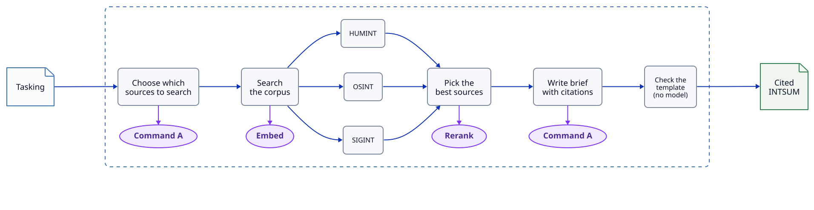

Scenario

- Analyst generates a report
- Specific date range and specific level of detail

Why Cohere?

- **Embed** provides semantic embedding over *multiple languages* for retrieval of chunks from Chroma DB
- **Rerank** *prioritizes* what information is passed into the brief
- **Command A** picks the sources and tiers (HUMINT/OSINT/SIGINT) by **native tool calling**; checkboxes override. It then composes with source citations

```
/make-brief Prepare a command-staff brief on Russian strikes on Ukrainian infrastructure in
December 2022 and the air defence response
```

</div>

## Demo follows a micro-services architecture

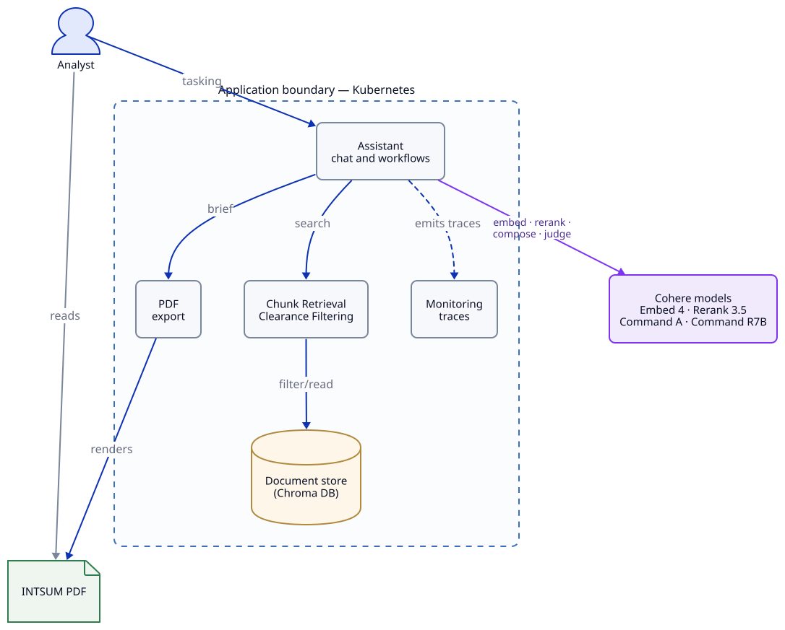

- Open source software components running on Kubernetes.
- Cohere models accessed through public APIs
- Runs locally on my laptop, but can run in any cloud with Kubernetes

## From documents to cited sentences

<div style="font-size:0.74em; line-height:1.2">

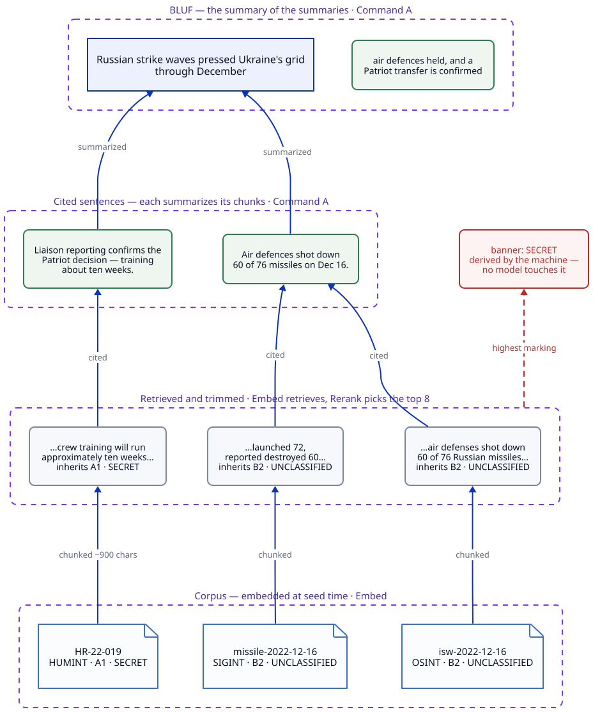

- Every chunk inherits its document's clearance and Admiralty grade; a citation binds a sentence to its chunks
- The hierarchy summarizes twice: cited sentences summarize chunks, and the BLUF summarizes the sentences

</div>

## Modify report by adding more detail to the request

<div style="font-size:0.74em; line-height:1.2">

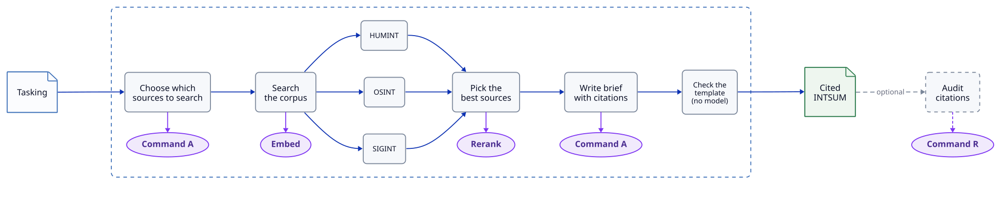

Scenario

- Analyst knows the reporting and detects missing information in the generated brief
- The gap is in reported Russian losses; one plain-text note resteers the generation

Why Cohere?

- **Command A** instruction following under a strict output contract — steered content, unmoved structure
- The full retrieve-rerank-compose pipeline re-runs on the fused question

```
/revise The brief is missing the reported Russian personnel and equipment losses over 
the same period. Add a section on them.
```

</div>

## Translate the report for coalition partners

<div style="font-size:0.74em; line-height:1.2">


Scenario

- Analyst needs to generate a report in differente languages
- A rendition, not a re-run
- Each sentence translates one-for-one; citations, Admiralty grades, and the banner are not passed through the model

Why Cohere?

- **Command A** is trained across 23 languages — French, German, Polish, and Romanian ride the demo dropdown
- The segments return through a forced tool call, so the mapping back to sources is exact

```
/translate french
```

</div>

## Generate intelligence report at different clearance levels

<div style="font-size:0.74em; line-height:1.2">


Scenario

- The HUMINT tier is field reporting at CONFIDENTIAL and SECRET; the other tiers are open
- At secret the Patriot tasking cites the SECRET liaison report; at unclassified it cannot
- /clearance (or the selector) sets the analyst level; rerunning the same tasking regenerates the brief under it

Why Cohere?

- **Embed** retrieval runs over the clearance-filtered corpus — chunks above the analyst's level are removed before any model sees them
- **Rerank** surfaces the source-protected report the moment clearance admits it

```
/clearance secret
 /make-brief Prepare a brief from HUMINT liaison reporting on the Patriot air-defence decision:
 confirmation, crew training timeline, and any second battery under discussion
```

</div>

## Audit the citations with a second model

<div style="font-size:0.74em; line-height:1.2">

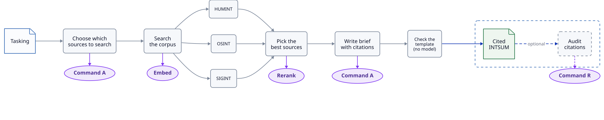

Scenario

- Analyst want to check the report
- Sentence by sentence a second model measures the quality of the summary

Why Cohere?

- **Command R** judges what **Command A** composed — the brief's citations audited against the documents themselves

```
/audit
```

</div>

## Auto-improve against audit

<div style="font-size:0.74em; line-height:1.2">

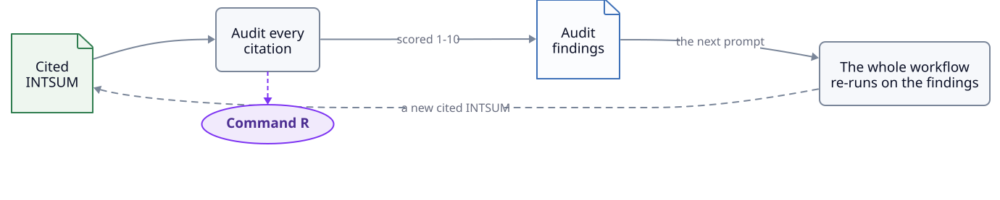

Scenario

- The audit findings become the next prompt and the workflow runs again
- Weak claims are rewritten against their sources or dropped; the classification level never goes down

Why Cohere?

- **Command (small)** judges; **Command A** rewrites — the same two models checking each other, now in a loop
- Every pass is traced: the judge's scores and the revision both sit in the trace panel

```
/refine
/refine 3
```

</div>

## Search the corpus without generating

<div style="font-size:0.74em; line-height:1.2">

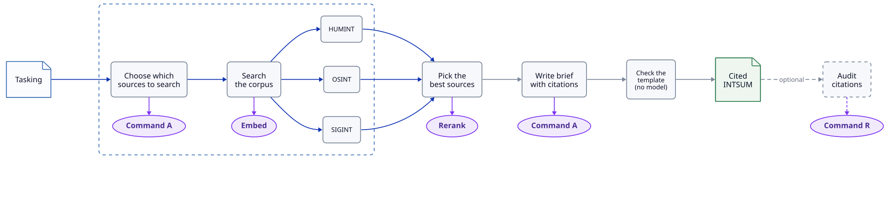

Scenario

- When the brief stops improving, the problem is the data; look at what the corpus holds
- Each result shows its source, clearance, and Admiralty grade; nothing is generated
- The same clearance filter applies as on every other command

Why Cohere?

- **Embed** retrieves asymmetrically: corpus as search documents, tasking as a search query
- One retrieval space across Russian, Ukrainian, and English reporting

```
/search interceptor expenditure in the december strike waves
```

</div>

## Add Internet reporting to the corpus

<div style="font-size:0.74em; line-height:1.2">

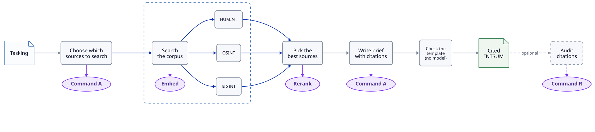

Scenario

- Analyst adds fresh open-source reporting to the corpus mid-session
- The receipt lists what was added; everything enters as unclassified, Admiralty F
- The next /search returns the new rows next to the internal reporting

Why Cohere?

- **Command A** proposes up to three search queries by **native tool calling**; the machine runs one search per query
- **Embed** on the ingest side — one embedding space, so web material and internal reporting rank against each other honestly

```
/harvest strikes on energy infrastructure, air defence interceptions, and 
reported Russian losses december 2022
```

</div>

## Deliver the brief as a document

<div style="font-size:0.74em; line-height:1.2">

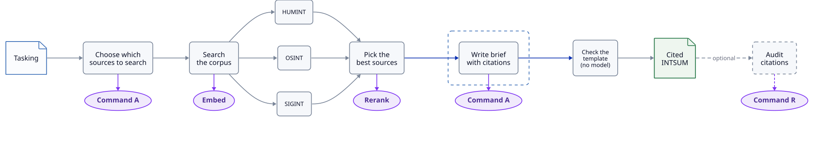

Scenario

- Analyst condenses the brief on screen into an executive summary
- The INTSUM form exports as a PDF in a new tab

Why Cohere?

- **Command A** writes the summary solo — no retrieval, only the brief on screen
- /export is deliberately not a model call; the deliverable path stays deterministic

```
/summarize
/export
```

</div>

## Ask only for the dates you mean

<div style="font-size:0.74em; line-height:1.2">


Scenario

- Analyst names a reporting window in the tasking
- The window becomes a declared metadata filter; every chunk carries its document's issued date

Why Cohere?

- **Command A native tool calling** turns "between 16 and 18 December" into a schema-fenced date window — a bad date fails the parse and falls back to full search, never to a wrong filter

```
/make-brief Prepare a brief on Russian strikes on Ukrainian infrastructure between
16 and 18 December 2022
```

</div>

## No data means no report

<div style="font-size:0.74em; line-height:1.2">

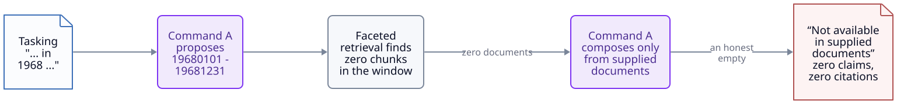

Scenario

- The tasking asks for a period the corpus does not cover
- Retrieval returns nothing and the brief says so — no report invented from another year's data

Why Cohere?

- **Command A grounded composition** writes only from supplied documents: zero documents in, zero claims out, zero citations

```
/make-brief Prepare a command-staff brief on strikes on infrastructure and the air
defence response in 1968
```

</div>

## Measure retrieval recall live

<div style="font-size:0.74em; line-height:1.2">

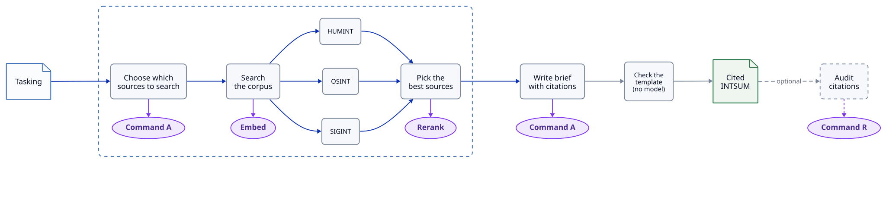

Scenario

- Analyst checks how well retrieval finds the reporting a tasking needs
- Per-tasking and aggregate recall over a generated reference set, against the 90% threshold
- The full harness compares the rerank order and the raw retrieval order at the same cutoff, and reports the retrieval ceiling separately

Why Cohere?

- **Rerank** is what the same-cutoff pair isolates
- **Command A** generated the reference questions and selects sources every turn by native tool calling

```
/eval 3
```

</div>

## Cohere offers a range of models enabling many analyst workflows

<div style="font-size:0.74em; line-height:1.2">

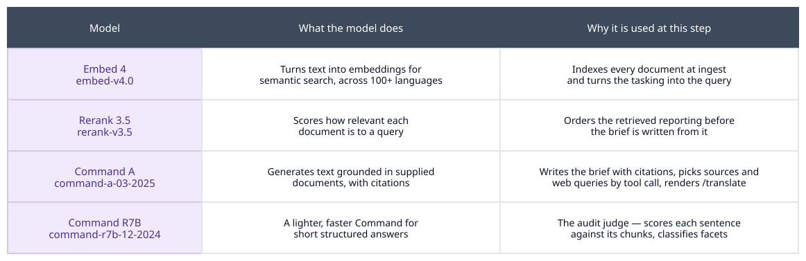

</div>

